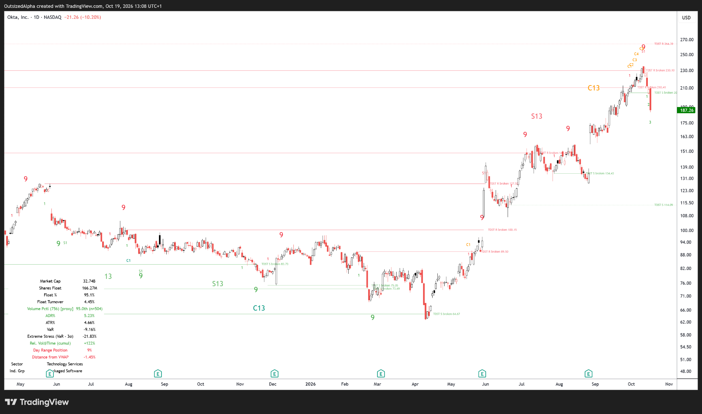

# OutsizedAlpha TD Sequential & Combo

**An independent Pine Script® v6 implementation of selected published DeMARK Setup, TD Sequential, TD Combo and TDST concepts for TradingView.**

[Source code](./OutsizedAlpha_TD_Sequential_Combo_Reviewed.pine) · [Changelog](./CHANGELOG.md) · [Contributing](./CONTRIBUTING.md) · [Licence](./LICENSE)

> **Independent, not official.** This is not DeMARK, Symbolik, Bloomberg or TradingView licensed source, and is not certified to reproduce the current proprietary implementations. The selectable rule variants and omissions are documented below. The indicator provides analytical references, not investment advice or automatic trading orders.

## Example chart — Okta (NASDAQ: OKTA)

*Daily NASDAQ:OKTA chart captured on 19 October 2026. The annotations illustrate TD Setup, Sequential, Combo and historical TDST levels, including confirmed break history. This is a historical visual example, not a trade recommendation or evidence of parity with licensed DeMARK indicators. Chart imagery © TradingView and respective data owners.*

## What it does

- **TD Setup:** buy/sell price-flip detection, 1–9 counts, optional completion-only display and first-1 markers.
- **Setup perfection:** immediate and later perfection monitoring, with inclusive or strict comparisons.
- **TD Sequential:** non-consecutive 1–13 countdowns, optional 8-versus-5 qualification, required-by-default 13-versus-8 qualification, deferred candidate handling and per-series cancellation.
- **TD Combo:** provisional counting from the originating Setup; accepted/visible retrospectively only when Setup 9 validates; adjustable comparison requirements and final-count strictness.
- **Recycling:** explicit policy for later same-direction Setups reaching 22; optional 100–200% relative Setup-size variant. Completed 13s can later be marked `R`.
- **TDST support/resistance:** all recorded still-live levels retained independently of chart drawings; qualified-break and disqualified-attempt tracking; view-window filtering to reduce chart compression.
- **TDST appearance:** default **1 px dotted while unconfirmed** and **1 px solid after a qualifying break**, separately adjustable (1–4 px, dotted/solid/dashed); optionally show completed-break history.
- **Exact Setup-1 anchoring:** TDST lines begin visually at the originating Setup 1 candle; levels are **not known or activated until Setup 9**.
- **Sequential risk references:** configurable optional price references on accepted 13s, using true extremes and true range from actual Countdown 1 through 13.
- **Status table and alerts:** live/drawn TDST counts, nearest hidden levels, countdown status and 24 `alertcondition()` definitions.

## Install in TradingView

1. Open a chart in [TradingView](https://www.tradingview.com/).
2. Open **Pine Editor**, create a new **Indicator** and open [the complete script](./OutsizedAlpha_TD_Sequential_Combo_Reviewed.pine).
3. Replace the editor contents, save and select **Add to chart**.
4. Under **Inputs**, tailor the appearance and analytical rules. To match default line styling: **TDST — Line Appearance → Unconfirmed: Dotted / 1 px; Confirmed: Solid / 1 px**.
5. Keep **TDST — Multiple Live Levels → Anchor Lines Back to Setup 1** enabled for the desired line start.

Copy the *entire* Pine source, not just the opening declarations. The repository does not install the indicator into a TradingView account automatically.

## Recommended defaults

| Setting | Default | Purpose |
| --- | --- | --- |
| TDST Display | Visible candle range | Filter drawings, not levels, to visible high–low range |
| Visible Range Padding | 0% | Avoid distant plotted levels affecting visual range |
| Maximum Drawn TDST Lines per Side | 12 | Live support and resistance budget, each side |
| Anchor Lines Back to Setup 1 | On | Align origin with actual Setup 1 candle |
| Unconfirmed Line Style / Width | Dotted / 1 px | Current live level |
| Confirmed Break Line Style / Width | Solid / 1 px | Retired level's historic segment |
| Show Confirmed Break History | On | Display qualified-break segments ending at break candle |
| Maximum Confirmed Break Lines per Side | 6 | Separate support and resistance history budgets |
| Qualified TDST Break Basis | Close | Confirmed close beyond level (with selected qualifier filter) |
| Require Sequential 13 vs 8 | On | Deferred, rather than falsely accepted, final candidate |
| Require Sequential 8 vs 5 | Off | Optional stricter version |
| Recycling | 22 only | Subsequent Setup policy; not proprietary parallel-count logic |

If price scaling remains compressed, TradingView's **Scale price chart only** chart option may help, particularly with **All live levels** selected. The script cannot toggle TradingView chart-scale settings itself.

## Understanding the colours and signals

The script uses **green buy Setup counts below bars**, **red sell Setup counts above bars**, **teal/orange Combo labels**, and **S/C-prefixed Sequential/Combo counts**. An accepted 9 or 13 marks completion of the *specific calculation*, not a guaranteed price turn or an instruction to buy/sell.

**TDST support** comes from the true-low extreme of a completed *sell* Setup's first nine bars. **TDST resistance** comes from the true-high extreme of a completed *buy* Setup's first nine bars. A TDST line can appear to start at Setup bar 1, but only becomes calculable upon completion of Setup 9. It remains live through failed/disqualified break attempts. Following a qualifying break, the history line becomes solid (by default), stops at the break bar and is no longer counted as live.

Dotted → solid describes **TDST break confirmation under the configured rule**, not confirmation of a 9/13 reversal prediction.

### Rule controls

**Sequential / Setup Rules:** strict-versus-inclusive prior price flip, deferred perfection equality, per-countdown TDST cancellation, 8-versus-5, 13-versus-8, final close versus open-or-close comparison, risk tie policy.

**Combo Rules:** four independently selectable tests (close versus high/low two bars earlier; prior-bar extreme; prior close; previously counted Combo close), optional equal extrema, and relaxed successive-counted-close bars 11–13.

**Recycling — Explicit Policy:** enable/disable; subsequent Setup reaches 22, optionally augmented by a 100–200% size test. An originating Setup reaching 22 does not recycle its own 13.

**TDST — Multiple Live Levels:** viewport-aware drawing choice, padding, line budgets, price labels, Setup 1 anchor, selectable published three-alternative breakout filter and confirmed-close / high-low penetration basis.

**TDST — Line Appearance:** separate live/confirmed line styles and widths; historical break display and independent budget.

## Important calculation and display limitations

1. **One active Sequential and one active Combo per direction**. This does not reproduce the hidden parallel-series selection of proprietary DeMARK platforms.
2. **Rule variants differ across published vintages and products.** Choosing optional tests changes historical signals. Exact Symbolik parity and all recycling/cancellation details are not established.
3. **Closed-bar logic:** engine state is committed when `barstate.isconfirmed` is true. Historical Combo labels for Setup 1–9 may be drawn retrospectively after Setup 9 validates; a completed 13 can later be relabelled `R` on recycling. Neither change was knowable on the earlier candle. Do not assert unconditional non-repainting.
4. **Viewport-aware TDST:** live/broken status is reconstructed **as of the rightmost viewed confirmed bar**. The separate Setup/Countdown table rows describe the *latest calculated* state, not necessarily that earlier date. Hiding a level does not remove it from the live registry.
5. **Loaded-history dependence:** availability, earlier origins and counts depend on the OHLC chart's available history, exchange session, feed, adjustment settings and chart type. Use ordinary OHLC bars for comparisons.
6. **Drawing and performance budgets:** label and line limits restrict visible annotations rather than invalidating signals. Very long histories can hit Pine runtime/data-resource limits. The code fails explicitly at its level-record capacity rather than silently expiring live levels.
7. **Risk levels are reference prices**, not an automatic stop strategy, order system or position-sizing rule.
8. The original custom **TD Propulsion** projection module was deliberately removed because its ratios were not verified as official.
9. **Validation boundary:** earlier independent synthetic/runtime checks were reported during development, but native TradingView compiler acceptance, live-tick behaviour, and pixel-accurate chart presentation were not independently verified here. If the Pine editor reports an error, please file an issue with the exact message and line number.

## Alerts

Create alerts via TradingView's alert dialogue, choosing this indicator and the desired condition. There are 24 named conditions covering Setup 9, accepted Sequential/Combo 13, deferred Sequential candidates, later perfection, cancellation, recycling, qualified/disqualified TDST breaks and the 12-bar Sequential response-review reminder. Multiple historical events may satisfy a condition, so use the alert frequency most appropriate to your intended workflow.

The 12-bar event is **a review reminder only**. It is not automatic invalidation.

## Development and testing

The repository intentionally keeps a **single canonical indicator file**; there is no separate runtime build process or packaged executable. Pine Script execution requires TradingView or an appropriate compatible runtime.

When proposing modifications, distinguish **signal-engine changes** from **drawing-only changes**, and supply a reproducible OHLC example or screenshot. Check at minimum: deferred 13 retry, cancellation against the count's *own* TDST, failed Combo Setup, retrospective Combo promotion, later perfection, recycling by a subsequent 22, disqualified TDST attempts and TDST chart-window changes preserving the signals.

See [CONTRIBUTING.md](./CONTRIBUTING.md) for issue and review guidance.

## Reference material

- [DeMARK Sequential overview](https://demark.com/sequential-indicator/)
- [Symbolik Sequential help](https://help.symbolik.com/hc/en-us/articles/37782822323987-DeMARK-Sequential-Indicator)
- [Published DeMARK 9–13 parameter description](https://in.tradingview.com/script/gVMuxasg-DeMARK-9-13/)
- [2007 DeMark interview – rules and qualification discussion](https://demark.com/wp-content/uploads/2025/07/2007-August-DeMark-Active-Trader-interview.pdf)
- [DeMark Indicators book excerpt (Wiley)](https://catalogimages.wiley.com/images/db/pdf/9781576603147.excerpt.pdf)
- [TradingView Pine Script documentation](https://www.tradingview.com/pine-script-docs/)

These references inform an **independent interpretation**. They do not imply endorsement, proprietary-source access or commercial equivalence.

## Licensing and attribution

Copyright © OutsizedAlpha. Source released under the **Mozilla Public License 2.0** — see [LICENSE](./LICENSE). Its file-level copyleft and notice requirements apply to distribution and modifications; it is not a waiver of DeMARK or TradingView trademarks.

**DeMARK, Symbolik and TradingView are names of their respective owners.** This project is unaffiliated with and not endorsed by those businesses. No proprietary DeMARK code is included.

**Disclaimer:** Educational/research charting tool; no guarantee of trading performance or investment outcomes.
